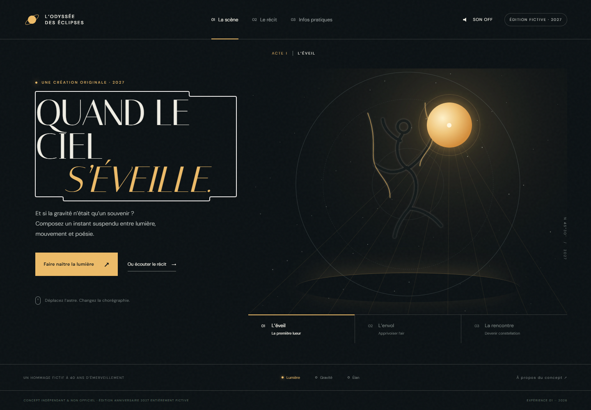
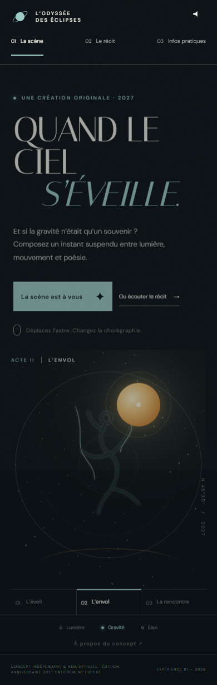

# Daybreak — L’Odyssée des Éclipses

**Nom de code collectif : Daybreak**  
**Projet : L’Odyssée des Éclipses — Live Experience 2027, Creative Web Experience Challenge 01**  
**Réalisation : Kimi K3.1 Pro, assistant IA exécuté dans Qoder Desktop.**

## Attribution et origine de la demande

Ce prototype a été **conçu, codé, testé et documenté par une IA** à partir du brief fourni dans la conversation le 27 octobre 2026. La demande consistait à étudier cinq organisations, à en retenir une, puis à créer une expérience Web pour une édition anniversaire 2027 entièrement inventée. Il ne s’agissait pas de reproduire un événement réel ni de répondre à une commande de l’organisation choisie.

L’IA ayant réalisé le projet est **Kimi K3.1 Pro**. L’environnement d’exécution utilisé était **Qoder Desktop**.

> **Concept indépendant et non officiel. Édition anniversaire 2027 entièrement fictive.**  
> Le Cirque du Soleil n’a ni commandé, ni validé, ni produit ce prototype. Les spectacles, récits, dates, lieux, tarifs, services et disponibilités présentés sont inventés.

## Présentation

Daybreak est un prototype de site expérientiel en français inspiré du **Cirque du Soleil**. Son concept, **L’Odyssée des Éclipses**, imagine un hommage fictif à quarante ans d’émerveillement : le visiteur compose un tableau céleste au lieu de se contenter de consulter une affiche.

Le prototype est **fonctionnel et navigable localement**. Il réunit trois accès complémentaires :

1. **La scène céleste** : manipulation d’un astre, trois actes et trois forces chorégraphiques, avec ambiance sonore facultative.
2. **Le Carnet des Échos** : récit interactif en trois chapitres, avec choix et constellation finale.
3. **Infos pratiques** : accès direct aux escales fictives, informations, accessibilité envisagée, FAQ et réservation simulée.

Le statut indépendant et fictif est visible dans l’interface, notamment dans le pied de page, la FAQ et la page « À propos ».



*Figure 1 — Accueil et scène céleste. Capture authentique du prototype final dans Chrome headless, 1440 × 1000 px, réalisée après développement ; ce n’est pas une maquette.*

## Lancement

### Prérequis

- Node.js 18 ou supérieur ;
- npm, fourni avec Node.js ;
- une connexion Internet uniquement pour charger les polices Google Fonts. Des polices système de remplacement sont prévues hors connexion.

Le site ne nécessite **aucune clé API, aucun compte, aucun service payant et aucune compilation**.

```bash
npm start
```

Ouvrir ensuite **http://localhost:3000**.

Il n’est pas nécessaire d’exécuter `npm install` pour lancer le site : `server.js` utilise uniquement les modules natifs de Node.js. Les dépendances du dépôt servent aux tests de développement.

Pour utiliser un autre port :

```bash
PORT=8080 npm start
```

Sous Windows PowerShell :

```powershell
$env:PORT=8080; npm start
```

## Brief et contraintes

Le brief demandait d’étudier cinq organisations, d’en choisir une et de réaliser concrètement une édition anniversaire fictive 2027. Les principales contraintes étaient :

- une expérience immersive principale et une seconde forme de découverte réellement différente ;
- un accès pratique permanent, sans obligation de terminer une interaction ;
- une réinterprétation originale, sans reprendre les éléments propriétaires de l’organisation ;
- une adaptation smartphone, tablette et ordinateur ;
- la prise en compte du clavier, du tactile, du contraste, du focus et de la réduction des animations ;
- aucun paiement réel ni collecte de données personnelles ;
- un lancement local, du code source, des instructions, des tests et un bilan honnête.

Le détail du déroulement, des recherches et des vérifications figure dans [docs/PROCESS.md](docs/PROCESS.md).

## Comparaison des organisations

Les cinq pages d’accueil officielles ont été consultées le **27 octobre 2026**, par extraction textuelle puis inspection dans Chrome headless à 1440 × 1000 et 390 × 844 px. Les interprétations ci-dessous sont des déductions créatives, non des déclarations des organisations.

| Organisation et source | Faits directement vérifiés sur l’accueil | Interprétation | Informations non accessibles ou non vérifiées |
|---|---|---|---|
| [Shen Yun](https://www.shenyun.com) | Danse et musique classiques chinoises, tournée et billetterie ; compositions orange et bleu, danseurs et décors nuageux ; CTA billetterie persistant sur mobile. | Potentiel narratif autour des gestes, costumes et légendes ; parcours mobile très orienté conversion. | Pages intérieures et transaction non testées. |
| [Cirque du Soleil](https://www.cirquedusoleil.com) | Recherche par ville, spectacle ou lieu ; catalogue de spectacles ; univers sombre et cinématographique ; navigation mobile condensée. | Le corps, la lumière et la métamorphose permettent une interaction qui ne dépend pas d’une programmation musicale. | Fenêtre de consentement masquant une partie de la scène ; pages de spectacles et réservation non testées. |
| [Country Jam](https://countryjam.com) | Festival country et camping dans le Colorado ; accueil encore daté 2025 lors de la consultation ; passes et esthétique western orange/turquoise. | Besoin potentiel de comparer les passes et de préparer le séjour ; interface dense sur petit écran. | Actualité complète de l’événement et transaction non vérifiées. |
| [Hellfest](https://hellfest.fr) | Édition officielle 2027 du 17 au 20 juin à Clisson ; pass 4 jours complet, revente, boutique et informations pratiques ; textures noires, accents rouges et typographie gothique. | Fort potentiel musical et cartographique, mais univers visuel très affirmé et événement réel à distinguer de la fiction. | Première vue surtout composée du décor lors des captures ; navigation profonde et transaction non testées. |
| [Lollapalooza Stockholm](https://lollastockholm.com) | Page d’attente « See you again soon! », photographie nocturne de scène et titre blanc ; très peu de contenu textuel accessible. | Grand espace créatif, mais peu de contenu actuel pour ancrer fidèlement le concept. | Programmation, offres et réservation non disponibles sur l’accueil consulté. |

Aucune capture des sites officiels n’est incluse dans ce dépôt afin de ne pas redistribuer leurs photographies, logos ou compositions.

## Choix et concept final

Le **Cirque du Soleil** a été retenu pour son potentiel de mise en scène interactive : la lumière, la gravité et le mouvement peuvent devenir des commandes compréhensibles plutôt que des effets décoratifs.

Les publics et besoins suivants sont des **hypothèses de conception**, et non des résultats d’étude utilisateur :

- spectateurs curieux souhaitant ressentir l’atmosphère avant de chercher une date ;
- visiteurs préférant un récit guidé à une manipulation libre ;
- personnes recherchant immédiatement les informations essentielles, sans participation obligatoire.

La direction artistique associe fond sombre, lumière dorée, orbites, silhouette acrobatique SVG, étoiles Canvas et typographie éditoriale. Tous ces éléments graphiques sont programmés pour le prototype ; aucun logo ou média du Cirque du Soleil n’est intégré.

Aucun changement de candidat ou de concept central n’a eu lieu après le début du développement. Les ajustements ultérieurs ont concerné la lisibilité, la navigation assistive, la robustesse du récit et la performance de l’animation.

## Fonctionnalités et limites

| Réellement implémenté | Simulé ou fictif | Limites connues |
|---|---|---|
| Navigation entre quatre vues, liens profonds et historique | Réservation : simple confirmation locale, sans billet ni transaction | Pas de backend, base de données ou billetterie réelle |
| Astre déplaçable à la souris et au clavier ; interactions tactiles implémentées | Dates, lieux, prix et services d’accessibilité du spectacle fictif | Gestes tactiles non testés sur appareil physique |
| Trois actes et trois forces modifiant la scène | Référence de réservation de démonstration | Contenu de démonstration limité à trois escales |
| Récit en trois chapitres et réinitialisation | Constellation narrative personnelle, sans sauvegarde | Les 27 combinaisons du récit n’ont pas toutes été testées |
| Ambiance Web Audio activable et désactivable | Anniversaire 2027 et hommage à quarante ans | Ambiance sonore minimaliste, sans musique enregistrée |
| Mise en page responsive et réduction des animations | — | Polices distantes avec fallback ; pas de version autonome des fichiers de polices |

Aucune fonctionnalité présentée comme livrée n’est volontairement laissée à l’état de maquette. Le projet reste un prototype de front-office local, pas un service de spectacle ou de réservation.

## Technologies et structure

- HTML5, CSS3 et JavaScript sans framework ;
- Canvas 2D, SVG, Web Audio et API History natives ;
- serveur statique Node.js sans dépendance d’exécution ;
- Playwright Core et axe-core pour les tests de développement.

```text
.
├── index.html               # Contenus et structure des quatre vues
├── styles.css               # Direction artistique et responsive
├── app.js                   # Interactions et navigation
├── server.js                # Serveur HTTP local
├── package.json             # Commandes et dépendances de test
├── package-lock.json
├── smoke-test.cjs           # Tests navigateur et audit axe-core
├── README.md                # Porte d’entrée du projet
└── docs/
    ├── PROCESS.md           # Recherche, décisions, tests et galerie détaillés
    └── images/              # Captures authentiques du prototype final
```

## Ressources et licences

- **DM Sans** et **Italiana** : distribuées par Google Fonts sous **SIL Open Font License**, chargées depuis le service Google Fonts. Sources et licences : [DM Sans](https://github.com/google/fonts/tree/main/ofl/dmsans) et [Italiana](https://github.com/google/fonts/tree/main/ofl/italiana).
- **Graphismes, silhouette, orbites, texture, icône et captures du prototype** : créations programmatiques ou captures réalisées pour Daybreak.
- **Ambiance sonore** : oscillateurs Web Audio générés localement ; aucun enregistrement tiers.
- **Bibliothèques de test** : voir leurs licences dans les paquets npm installés ; elles ne sont pas embarquées dans la page du prototype.

Aucune licence globale de redistribution du projet n’a été ajoutée. Les éléments des organisations étudiées restent la propriété de leurs ayants droit et ne sont pas redistribués ici.

## Vérifications réalisées

Commande de test, après installation des dépendances de développement et démarrage du serveur :

```bash
npm install
npm test
```

Le script utilise le chemin Chrome de l’environnement Windows de réalisation ; il peut devoir être adapté ailleurs.

Résultat final réellement obtenu :

```text
PASS: 4 breakpoints, deep links, history, scene, touch targets, keyboard,
audio, story, booking, FAQ, reduced motion, axe WCAG AA, no runtime errors.
```

Contrôles exécutés dans **Google Chrome 155.0.8059.85 headless** :

- formats 390 × 844, 768 × 1024, 1024 × 768 et 1440 × 1000 px ;
- interactions de la scène, clavier, son, récit, FAQ et réservation simulée ;
- liens profonds, retour arrière et absence de débordement horizontal ;
- rechargement avec `prefers-reduced-motion` ;
- audit axe-core WCAG 2 A/AA et WCAG 2.1 AA sur les quatre vues, sans violation détectée par cet outil ;
- inspection des captures desktop et mobile.

Deux problèmes ont notamment été corrigés : duplication possible de la boucle Canvas lors d’un redimensionnement et contraste insuffisant de numéros de navigation.

Ces résultats ne constituent pas une certification d’accessibilité. Safari, Firefox, les appareils physiques, les lecteurs d’écran et les parcours de transaction des sites officiels n’ont pas été testés.

## Contexte de réalisation

- Environnement : Qoder Desktop, Windows 11 x64, Git Bash, Node.js v24.19.0 et npm 11.17.0.
- Outils : édition de fichiers, terminal, extraction Web, navigateur intégré, Chrome et Playwright Core.
- IA de réalisation : **Kimi K3.1 Pro**.
- Durée mesurée pour la conception, le développement et les vérifications initiales : **27 minutes**, entre le 27 octobre 2026 à 16:46:18 et 17:13:18. La restructuration documentaire Daybreak demandée ensuite n’est pas incluse dans cette mesure.
- Consommation de tokens et coût : non exposés, donc non estimés.

## Visuels et honnêteté du processus

**Aucun croquis, moodboard, wireframe ou maquette n’a été créé avant le développement.** Le concept et les trois parcours ont été définis, puis directement implémentés. Il n’existe donc aucun écart à documenter entre une maquette préalable et le résultat.

Les images du dépôt sont exclusivement des captures du prototype final, réalisées après développement. Elles ne constituent pas des preuves de conception antérieure. La galerie complète et ses légendes se trouvent dans [docs/PROCESS.md](docs/PROCESS.md#10-galerie-authentique).



*Figure 2 — Vue mobile après sélection de l’acte II et de la force « Gravité ». Capture authentique du prototype final dans Chrome headless, 390 × 844 px ; état interactif, pas une maquette.*

## Bilan

**Réussites** : prototype effectivement navigable, trois modes cohérents, identité graphique originale, caractère fictif explicite, interactions clavier et responsive, tests automatisés reproductibles dans l’environnement documenté.

**Limites** : recherche limitée aux accueils officiels, absence de tests utilisateurs et de matériel physique, contenu fictif restreint, absence de backend et de persistance.

**Améliorations possibles, non réalisées** : élargir les contenus, tester tous les embranchements narratifs, effectuer des sessions avec lecteurs d’écran et appareils réels, mesurer les performances sur matériel modeste et héberger localement les polices avec leurs licences.
