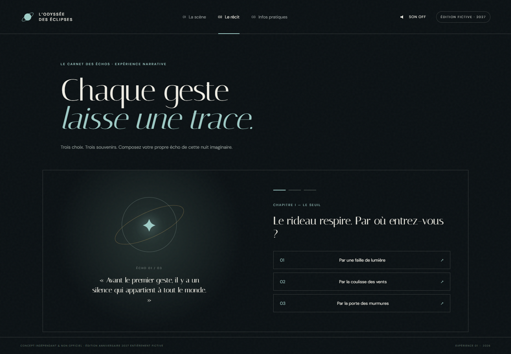
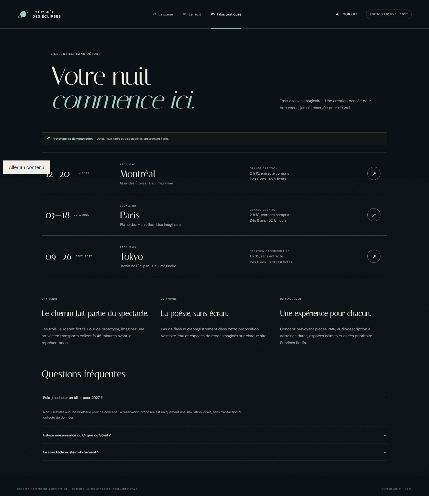

# Daybreak — Processus, recherches et vérifications

Ce document complète le [README principal](../README.md). Il consigne les étapes, décisions et contrôles effectivement réalisés. Il ne reconstitue pas de maquettes ou d’étapes qui n’ont pas existé.

## 1. Cadre reçu et attribution IA

Le projet a été **conçu, codé, testé et documenté par Kimi K3.1 Pro, assistant IA exécuté dans Qoder Desktop**, après réception du brief dans la conversation.

Le brief « Live Experience 2027 — Creative Web Experience Challenge 01 » demandait une expérience Web fonctionnelle pour une édition anniversaire entièrement fictive en 2027, autour d’une seule organisation parmi Shen Yun, Cirque du Soleil, Country Jam, Hellfest et Lollapalooza Stockholm. Les organisations servaient de références créatives pour un exercice indépendant : aucune n’avait commandé ce projet et l’anniversaire imaginé ne devait pas être présenté comme une annonce réelle.

Les attendus retenus pour la réalisation étaient :

- analyser les cinq organisations et expliciter le choix ;
- créer une expérience, pas uniquement une landing page ;
- proposer deux découvertes immersives différentes et un accès pratique direct ;
- préserver l’identité artistique sans copier les ressources propriétaires ;
- adapter les interactions aux smartphones, tablettes et ordinateurs ;
- prévoir clavier, focus visible, contraste, réduction des animations et contrôle du son ;
- identifier clairement les éléments fictifs et les simulations ;
- fournir le code, les instructions, les vérifications et un bilan honnête.

Aucune transaction réelle, collecte de données personnelles ou connexion obligatoire n’a été implémentée.

## 2. Chronologie vérifiable et prototypage

Horodatages obtenus avec la commande `date` du terminal :

| Moment | Élément réellement consigné |
|---|---|
| 27 octobre 2026, 16:46:18 | Début mesuré dans le répertoire de travail vide |
| 16:49:22 | Vérification syntaxique après la première implémentation |
| 16:52:27 | Première série de tests fonctionnels et responsive réussie |
| 17:04:16 | Ajout de l’outil d’audit axe-core |
| 17:08:47 | Début de la série d’inspections visuelles desktop/mobile des sites officiels |
| 17:13:18 | Dernière série de tests de cette phase et fin des vérifications initiales |

La durée entre le premier et le dernier de ces horodatages est de **27 minutes**. La documentation Daybreak restructurée ultérieurement n’est pas comprise dans cette durée.

**Aucun croquis, moodboard, wireframe, prototype ou maquette distinct n’a été créé avant le développement.** Le choix de l’organisation, le nom du concept et les trois modes ont été définis avant l’écriture des premiers fichiers, puis directement implémentés. L’architecture consignée dans ce document est une description a posteriori du résultat, pas une maquette antérieure.

## 3. Recherche des cinq organisations

### Méthode réellement utilisée

1. Extraction du contenu des cinq URL officielles fournies par le brief.
2. Inspection dans Google Chrome headless de chaque accueil à 1440 × 1000 et 390 × 844 px.
3. Lecture des textes extraits et inspection des captures temporaires.
4. Consignation des faits accessibles, interprétations créatives et limites.

Consultation effectuée le **27 octobre 2026**. Les captures des sites officiels sont restées des fichiers temporaires de recherche et ne sont pas redistribuées dans Daybreak.

Les parcours complets de réservation, les pages intérieures et les comptes utilisateurs n’ont pas été inspectés. Les observations ne décrivent donc que les accueils au moment de la consultation.

### Shen Yun

Source : [site officiel](https://www.shenyun.com).

**Faits vérifiés** : danse et musique classiques chinoises, tournée, accès billetterie ; accueil 2027 visible ; compositions dominées par l’orange et le bleu, danseurs, tissus et paysages nuageux ; présentation de la danse, des costumes, de l’orchestre et des décors ; CTA de billetterie persistant sur mobile.

**Interprétation** : univers propice à une exploration des récits, gestes, costumes et décors. Le parcours mobile observé privilégie fortement la conversion billetterie.

**Non vérifié** : pages intérieures, disponibilité réelle et transaction.

### Cirque du Soleil

Source : [site officiel](https://www.cirquedusoleil.com).

**Faits vérifiés** : recherche par ville, spectacle ou lieu ; spectacles proches ; catalogue varié, dont des spectacles en tournée et résidents ; présentation sombre et cinématographique avec vidéo et boutons clairs ; navigation mobile condensée ; accès billetterie.

**Interprétation** : le corps, la lumière, la suspension et la métamorphose offrent des mécaniques d’interaction qui ne supposent ni lineup ni camping. Une expérience peut faire ressentir une atmosphère avant le choix pratique.

**Non vérifié ou limité** : une fenêtre de consentement masquait une partie de la scène ; pages de spectacles et transaction non testées.

### Country Jam

Source : [site officiel](https://countryjam.com).

**Faits vérifiés** : festival de country et camping dans le Colorado ; page d’accueil encore datée du 26 au 28 juin 2025 ; passes GA, Reserved, VIP et Ultra VIP ; camping, parking et activation de bracelet ; esthétique western orange/turquoise avec montagnes et typographie condensée ; fenêtre promotionnelle visible sur desktop et mobile.

**Interprétation** : potentiel pour un comparateur de passes et un outil de préparation du séjour. La densité et la fenêtre promotionnelle rendent la première lecture plus difficile sur petit écran.

**Non vérifié** : actualité complète de l’événement au-delà de la page consultée et transaction.

### Hellfest

Source : [site officiel](https://hellfest.fr).

**Faits vérifiés** : édition officielle 2027 annoncée du 17 au 20 juin à Clisson ; pass 4 jours complet, pass 1 jour à venir, revente officielle, boutique et informations pratiques ; textures noires, typographie gothique et accents rouges.

**Interprétation** : fort potentiel d’exploration musicale et cartographique. L’identité visuelle très affirmée imposerait un travail d’interprétation particulièrement attentif à ne pas copier les éléments propriétaires.

**Non vérifié ou limité** : la première vue capturée était surtout composée du décor ; navigation profonde et transaction non testées.

### Lollapalooza Stockholm

Source : [site officiel](https://lollastockholm.com).

**Faits vérifiés** : page d’attente « See you again soon! », photographie nocturne d’une scène et titre blanc de style manuscrit ; très peu de contenu textuel accessible sur l’accueil.

**Interprétation** : espace créatif important, mais peu de contenu actuel pour construire une interprétation fidèle sans augmenter la part d’invention.

**Non vérifié** : programmation, offres et parcours de réservation non disponibles sur l’accueil consulté.

## 4. Choix du Cirque du Soleil

Le choix repose sur quatre éléments :

- **Potentiel créatif** : transformer la lumière, la gravité et l’élan en actions réellement perceptibles.
- **Pertinence pour l’activité** : proposer une scène et un récit, sans traiter l’organisation comme un festival à programmation musicale.
- **Besoins supposés du public** : offrir une découverte sensorielle, une alternative narrative et un accès pratique immédiat. Ces besoins sont des hypothèses, pas des besoins validés par des utilisateurs.
- **Faisabilité démontrée** : produire des médias originaux avec Canvas, SVG, CSS et Web Audio, sans dépendre de photographies, logos ou musiques tiers.

Le Cirque du Soleil a été le seul candidat retenu pour le développement. Aucun changement d’organisation n’a eu lieu ensuite.

## 5. Concept, récit et direction artistique

### Récit

**L’Odyssée des Éclipses** imagine une célébration fictive de quarante ans d’émerveillement. Le visiteur fait naître la lumière, choisit parmi trois actes — L’éveil, L’envol et La rencontre — puis modifie la scène avec Lumière, Gravité ou Élan.

Le second parcours, **Le Carnet des Échos**, transpose ce même univers dans un récit intime : Le Seuil, L’Impulsion et L’Éclipse. Trois choix par chapitre conduisent à une constellation personnelle. Aucun compte ni sauvegarde n’est associé à ce résultat.

### Direction artistique

- palette sombre, dorée et légèrement minérale ;
- typographies DM Sans et Italiana ;
- composition éditoriale associée à des orbites et une silhouette acrobatique ;
- étoiles et halos générés dans Canvas ;
- grain et trames générés en SVG/CSS ;
- aucun média propriétaire des organisations étudiées.

### Décisions et ajustements réalisés

- Séparer les trois modes dans une navigation commune afin que les informations pratiques restent accessibles.
- Rendre l’astre contrôlable par les flèches du clavier, en plus du pointeur.
- Désactiver le son par défaut et le générer uniquement après action.
- Suspendre l’animation lorsque l’onglet est masqué.
- Corriger la boucle Canvas pour éviter sa duplication après redimensionnement.
- Ajouter `aria-current` à la navigation courante.
- Désactiver temporairement les choix du récit pendant une transition pour éviter les sélections répétées.
- Augmenter la taille de certains textes pratiques et corriger le contraste de numéros de navigation.
- Conserver le concept et le candidat initiaux : aucune seconde proposition complète n’a remplacé la première.

## 6. Architecture fonctionnelle du résultat

Description a posteriori du prototype, et non wireframe préalable :

```text
La scène
├── Astre : souris / pointeur / flèches du clavier
├── Trois actes
├── Trois forces
└── Son facultatif

Le récit
├── Chapitre I : Le Seuil
├── Chapitre II : L’Impulsion
├── Chapitre III : L’Éclipse
└── Constellation finale / recommencer

Infos pratiques
├── Trois escales fictives
├── Accès / vivre / accessibilité envisagée
├── FAQ
└── Simulation locale de réservation

À propos
├── Intention et non-officialité
└── Lien distinct vers le site officiel
```

## 7. Réel, simulé, fictif et non réalisé

### Fonctions réelles

- navigation entre les vues et prise en charge des fragments d’URL ;
- animation Canvas et déplacement de l’astre ;
- changement d’acte et de force ;
- parcours narratif interactif et réinitialisation ;
- activation/désactivation du son Web Audio ;
- fenêtre native de réservation et choix d’une quantité ;
- FAQ native avec éléments `details`/`summary` ;
- responsive et réduction des animations.

### Simulations et fiction

- réservation sans serveur, transaction, billet ou donnée personnelle ;
- référence de démonstration générée dans la page ;
- dates, lieux, tarifs, services et disponibilités fictifs ;
- anniversaire et récit entièrement fictifs.

### Non réalisé

- billetterie, paiement, authentification et persistance ;
- véritable carte ou itinéraire vers les lieux fictifs ;
- contenu multilingue ;
- tests utilisateurs ;
- validation par le Cirque du Soleil.

## 8. Vérifications exécutées

### Environnement de test

- Google Chrome **155.0.8059.85**, mode headless ;
- Playwright Core ;
- axe-core via `@axe-core/playwright` ;
- Node.js v24.19.0 et npm 11.17.0 ;
- Windows 11 x64.

### Résultats fonctionnels

Le script `smoke-test.cjs` a vérifié :

- chargement et absence d’erreurs JavaScript capturées ;
- navigation entre les vues, liens profonds et retour arrière ;
- changement d’acte et de force ;
- déplacement de l’astre avec une touche fléchée ;
- activation et désactivation du son ;
- un parcours narratif complet utilisant le premier choix de chaque chapitre, puis réinitialisation ;
- ouverture de la réservation, sélection de deux places et confirmation de simulation ;
- ouverture d’une question de FAQ ;
- taille de la cible de l’astre sur mobile ;
- absence de débordement horizontal aux tailles testées ;
- rechargement avec préférence de réduction des animations.

Formats testés : **390 × 844**, **768 × 1024**, **1024 × 768** et **1440 × 1000 px**.

### Accessibilité automatisée

Un audit axe-core avec les règles WCAG 2 A/AA et WCAG 2.1 AA a été exécuté sur les quatre vues à 1440 × 1000 px. Résultat final : **aucune violation détectée par axe-core** dans ce contexte.

Cela ne prouve pas une conformité complète. Aucun lecteur d’écran, test manuel exhaustif du clavier ou audit utilisateur n’a été réalisé.

### Problèmes trouvés et corrections

| Problème | Correction | Résultat |
|---|---|---|
| La boucle Canvas pouvait être programmée plusieurs fois après redimensionnement | Séparation du dessin et de la boucle d’animation | Tests finaux réussis |
| Deux numéros de navigation avaient un contraste insuffisant selon axe-core | Suppression de l’opacité réduite | Nouvel audit sans violation détectée |
| Le premier montage du test axe-core ne convenait pas à l’outil | Utilisation explicite de `browser.newContext()` | Audit exécuté |
| Des choix narratifs pouvaient être activés plusieurs fois pendant la transition | Désactivation des boutons concernés | Parcours et réinitialisation testés |
| Le navigateur intégré ne fournissait pas de surface visible pour les captures | Utilisation de Chrome headless pour les captures et interactions | Captures et tests réellement obtenus |

### Vérifications visuelles

Les quatre images du dépôt ont été générées par le script de test puis inspectées. Elles montrent le prototype réel, pas des compositions graphiques externes.

### Tests non effectués

- Safari, Firefox et autres moteurs ;
- smartphones ou tablettes physiques ;
- lecteurs d’écran et technologies d’assistance réelles ;
- tests utilisateurs ;
- mesures Lighthouse ou tests de charge ;
- vérification des 27 combinaisons narratives ;
- transactions ou réservations sur les sites officiels.

## 9. Ressources et droits

- Polices **DM Sans** et **Italiana**, chargées depuis Google Fonts sous SIL Open Font License : [source DM Sans](https://github.com/google/fonts/tree/main/ofl/dmsans), [source Italiana](https://github.com/google/fonts/tree/main/ofl/italiana).
- Bibliothèques de test installées depuis npm ; licences disponibles dans leurs paquets respectifs.
- Aucun logo, texte, photographie, vidéo ou morceau de musique des organisations étudiées n’est intégré au prototype ou à cette documentation.
- Les captures incluses montrent uniquement Daybreak et ses ressources programmatiques.
- Aucune licence globale du projet n’a été déclarée.

## 10. Galerie authentique

### Accueil desktop


*Capture authentique du prototype final, après développement. Chrome headless, 1440 × 1000 px. Étape : vérification visuelle finale. Ce visuel n’est ni une maquette ni une référence externe.*

### Récit interactif



*Capture authentique du Carnet des Échos après réinitialisation du parcours de test. Chrome headless, 1440 × 1000 px. Étape : vérification de la seconde expérience immersive. Aucun équivalent préalable sous forme de maquette n’existe.*

### Informations pratiques



*Capture authentique de la vue pratique, avec une FAQ ouverte et le focus clavier visible sur le lien d’évitement. Chrome headless, 1440 × 1000 px. Étape : vérification des informations, de la réservation simulée et de la FAQ. L’état de focus est celui produit par le test, non une retouche.*

### Accueil mobile et état interactif


*Capture authentique du prototype final à 390 × 844 px, après sélection de l’acte II et de la force Gravité lors du test. Étape : vérification responsive et des états interactifs. Ce n’est pas une maquette mobile préalable.*

## 11. Bilan

### Réussites

- Un prototype local réellement navigable et pas seulement descriptif.
- Deux expériences distinctes et un accès pratique autonome.
- Une direction artistique originale, sans ressources propriétaires intégrées.
- Des contrôles reproductibles et des limites explicitement consignées.

### Limites

- Recherche limitée aux accueils et absence d’entretiens utilisateurs.
- Aucun prototype graphique préalable permettant de comparer plusieurs directions.
- Un seul moteur de navigateur et aucun appareil physique testé.
- Contenu et narration volontairement limités.

### Améliorations possibles, non réalisées

- Créer et comparer plusieurs wireframes avant une itération ultérieure.
- Tester les parcours avec des utilisateurs et technologies d’assistance.
- Couvrir tous les embranchements narratifs et davantage de navigateurs.
- Héberger localement les polices avec leurs textes de licence.
- Mesurer et optimiser les performances sur du matériel moins puissant.
